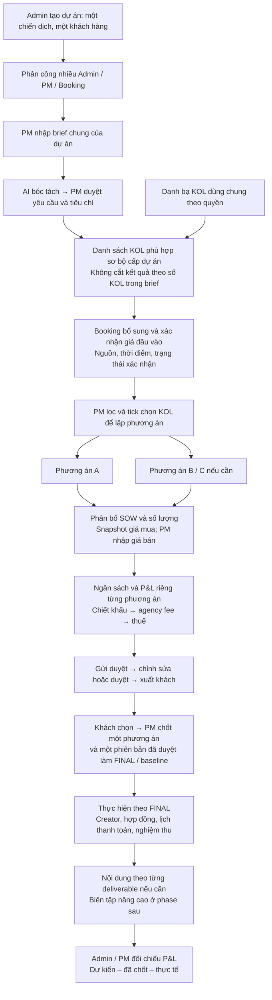
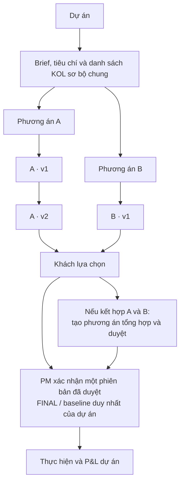
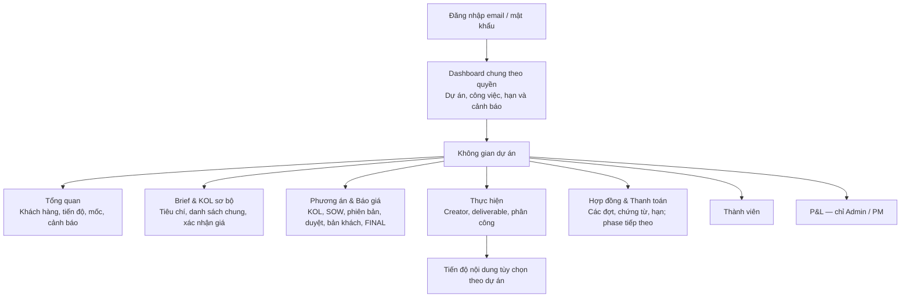
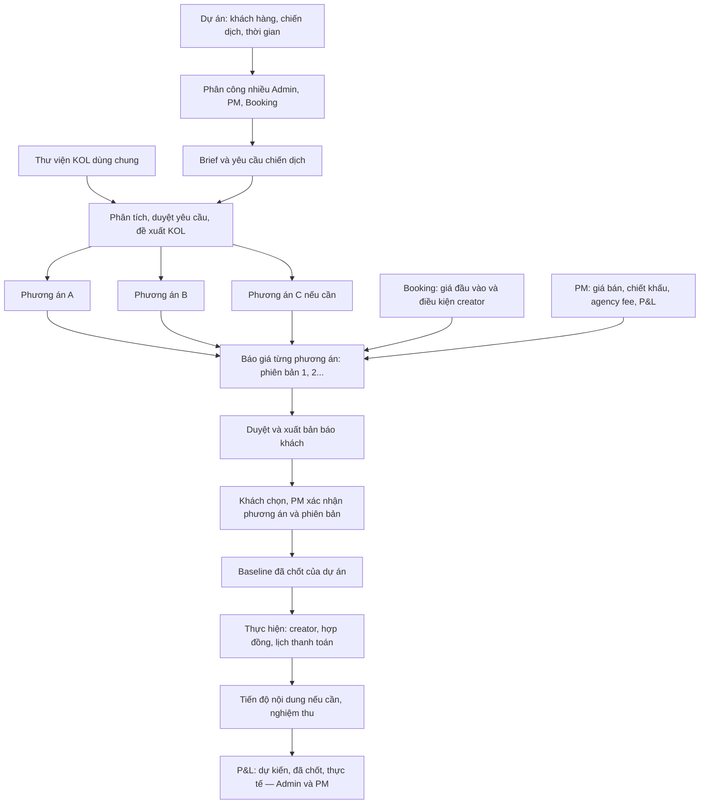
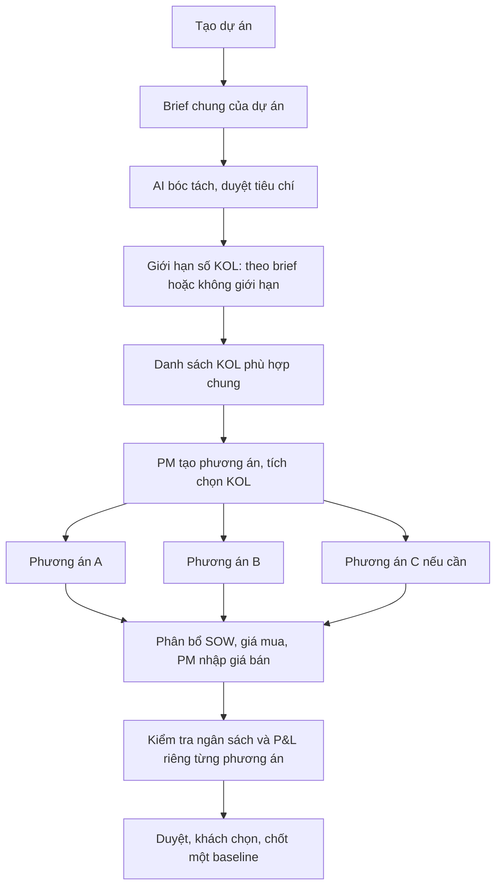
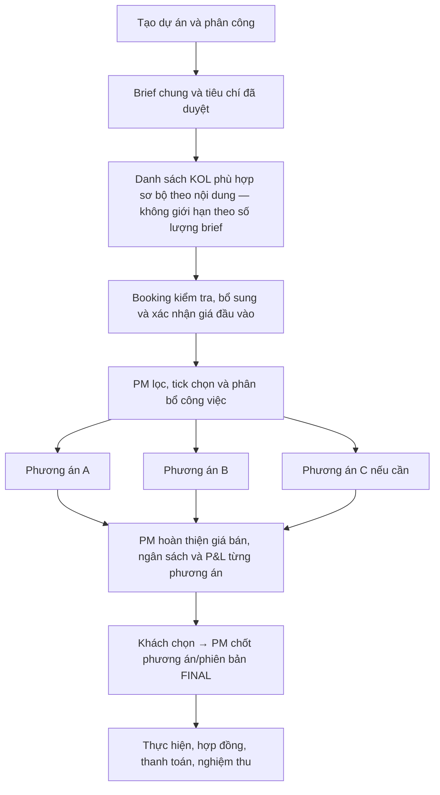

# Luồng dự án → báo giá → thực hiện → P&L

Cập nhật ngày 22/10/2026. Bản tổng hợp hiện hành bên dưới ưu tiên hơn các mục lịch sử ở cuối tài liệu. Đây là đặc tả; không đồng nghĩa toàn bộ flow đã được triển khai.

## 1. Hiện trạng và phạm vi kiểm chứng

- Đã có đăng nhập email/mật khẩu, tài khoản, dự án và thành viên trên SQLite local; xem LOGIN-AND-PROJECTS.md.
- Mã local hiện đã nối `server/projectQuotes.ts` và `ProjectQuotesPanel.tsx`: phương án trong dự án, phiên bản, giá mua/bán, trạng thái duyệt, baseline và bản khách. Đây là đối chiếu mã nguồn, chưa kiểm chứng vận hành hoặc nghiệm thu trong lượt cập nhật tài liệu này.
- Phần báo giá local hiện vẫn nhập brief theo phương án. Flow brief chung → danh sách sơ bộ → Booking xác nhận giá → PM lập phương án bên dưới là mục tiêu tiếp theo, chưa coi đã có.
- KOL/SOW legacy vẫn ở localStorage và chỉ Admin dùng; báo giá mới theo dự án không đồng nghĩa dữ liệu legacy đã được chuyển. Không tự migration hoặc sửa dữ liệu thật.
- Dashboard công việc, thực hiện, hợp đồng/thanh toán và nội dung nâng cao là mục tiêu, chưa tuyên bố đã triển khai.

## 2. Flow mục tiêu mới nhất

- Không có Top N hay chế độ giới hạn kết quả theo số lượng brief. Có thể phân trang; số KOL mục tiêu và tổng deliverables chỉ dùng đối chiếu lựa chọn/phân bổ.
- Không tự bù KOL không phù hợp, không tự đưa toàn bộ danh sách sơ bộ vào phương án hoặc lưu báo giá khi tìm kiếm.
- Booking theo dõi chờ giá / có giá / chờ xác nhận / đã xác nhận. Có số giá không đồng nghĩa đã xác nhận.
- Chưa quyết định khóa cứng tạo phương án khi giá chưa xác nhận. Nếu tiếp tục với giá thiếu/chưa xác nhận, hiển thị rõ trạng thái; không tuyên bố P&L hoàn chỉnh.
- Đề xuất dựa trên nội dung và tiêu chí; giá thiếu/vượt ngân sách là cảnh báo, không âm thầm loại toàn bộ KOL do ngân sách chiến dịch chưa phân bổ.

## 3. Dự án, phương án, phiên bản và FINAL

- Phương án là lựa chọn song song; phiên bản là lịch sử sửa một lựa chọn. Một KOL có thể thuộc nhiều phương án, với SOW, số lượng và giá bán khác nhau.
- Không thêm trùng creator ngoài ý muốn trong danh sách một phương án; một creator vẫn có nhiều dòng format/phase, phân biệt bằng itemId.
- Mỗi phương án/phiên bản giữ snapshot thông tin và giá mua. Sửa brief/danh bạ không tự sửa báo giá; PM chủ động làm mới ở bản nháp.
- Chưa có baseline: xem P&L từng phương án. Có baseline: P&L dự án dựa trên đúng bản đã chốt, không cộng phương án/phiên bản khác.
- Sau FINAL, thay đổi phải tạo phiên bản mới và duyệt lại; không sửa âm thầm bản đã chốt.

## 4. Kiến trúc màn hình mục tiêu

Dashboard chung tổng hợp theo quyền; tổng quan dự án chỉ tập trung một dự án. Booking có vùng công việc và giá đầu vào; các phần giá bán, chiết khấu khách, agency fee, xuất giá khách và P&L không được gửi qua API rồi chỉ ẩn giao diện.

## 5. Vai trò và trách nhiệm

| Vai trò | Phạm vi và công việc |
|---|---|
| Admin công ty | Xem toàn công ty; tài khoản, dự án, phân công; xem tài chính |
| PM / Admin dự án | Quản lý toàn bộ dự án được giao; brief, phương án, giá bán, duyệt theo quyền, chốt FINAL và P&L |
| Booking (gộp Account) | Trong phạm vi được giao: giá đầu vào, hồ sơ, creator support; không xem/sửa giá bán, agency fee, chiết khấu khách, P&L |

Giá / hồ sơ / creator support là phân công trách nhiệm, có thể kiêm nhiệm; không tạo vai trò riêng. Người phụ trách giá và hồ sơ cùng làm trên một hạng mục, không ghi thành hai khoản chi.

Luồng duyệt mục tiêu: Nháp → Chờ duyệt → Đã duyệt → Đã gửi khách; trả lại → Cần chỉnh sửa → Nháp. FINAL là lựa chọn baseline của dự án, không phải mọi bản đã duyệt đều là FINAL. Quy tắc chống tự duyệt/ngoại lệ cần đối chiếu nghiệm thu riêng, không mặc nhiên coi mã local đã thực hiện đủ.

## 6. Ngân sách và tài chính

- Phân bổ SOW và số lượng trước khi kết luận ngân sách; không nhân nguyên tổng deliverables cho từng KOL.
- Tổng hạng mục bán S − chiết khấu D = cơ sở fee B; doanh thu trước thuế R = B + agency fee; tổng khách trả = R + thuế.
- P&L = R − chi phí KOL và chi phí trực tiếp (buzz, seeding, sản xuất, đi lại nếu có); chưa phân bổ lương/chi phí chung.
- Giá chưa biết là null, không phải 0. Chưa nhập giá bán thì chỉ có dự toán đầu vào, chưa đủ dữ liệu kết luận ngân sách báo khách.
- So ngân sách khách với tổng báo khách sau chiết khấu và gồm fee là đề xuất hiển thị; phải ghi rõ trước/sau thuế, không tự hiểu ngân sách brief gồm VAT.
- Hiển thị số KOL so mục tiêu, deliverables đã phân bổ, hạng mục thiếu giá và mức vượt/còn khi đủ dữ liệu.
- Actual thay thế dự kiến của cùng khoản chi, không cộng hai lần. Thiếu actual thì ghi “Chưa đủ dữ liệu”; forecast dùng ước tính phải ghi rõ.
- Thu/chi và công nợ theo dõi riêng; tiền thu được không đồng nghĩa lợi nhuận.

## 7. Phần cần hoàn thiện theo flow mới

1. Brief, tiêu chí đã duyệt và danh sách sơ bộ gắn projectId, thay cho brief riêng từng phương án.
2. Bỏ giới hạn số kết quả theo brief; giữ số lượng mục tiêu để đối chiếu.
3. Bổ sung xác nhận giá của Booking với trạng thái, nguồn và thời điểm.
4. PM tick chọn từ danh sách chung để tạo phương án, phân bổ SOW và snapshot giá.
5. Đối chiếu quyền trường, duyệt, baseline và kiểm tra ngân sách với mã báo giá local; nghiệm thu trước khi coi hoàn tất.
6. Migration legacy chỉ khi người dùng chủ động xác nhận dự án, backup và giá mua chưa xác nhận; không tự chuyển dữ liệu.

---

## Lịch sử các chốt trước — chỉ để tham chiếu

Các phần dưới giữ nguyên để tra cứu. Nếu có khác biệt, áp dụng bản tổng hợp hiện hành ở trên; đặc biệt không áp dụng lại Top N hoặc flow tạo phương án trước brief chung.

## Hiện trạng

Đã có tài khoản, dự án và phân công thành viên. KOL/SOW cũ vẫn ở trình duyệt, chỉ Admin xem; chưa có projectId trong báo giá. Chọn project hiện CHƯA lọc hay liên kết SOW. Không có bước tự chuyển dữ liệu.

## Luồng mục tiêu đã thống nhất

1. Admin tạo dự án (tên, khách hàng, ngày dự kiến); phân công nhiều PM/Booking. Phân công theo dự án và có thể bổ sung theo creator ở bước sau.
2. PM nhập brief trong dự án. Phân tích AI → duyệt yêu cầu và tổng deliverables → tìm/chọn KOL từ danh bạ dùng chung có quyền.
3. Tạo phiên bản báo giá thuộc projectId. Mỗi dòng chứa creator, phase, SOW, số lượng, giá đầu vào và giá báo khách; thêm buzz/seeding và chi phí trực tiếp khác.
4. Tổng các hạng mục bán → trừ chiết khấu → tính agency fee → tổng trước thuế → thuế → tổng thanh toán. P&L = doanh thu trước thuế − chi phí trực tiếp, không coi giá chưa biết là 0.
5. Gửi duyệt, yêu cầu sửa hoặc duyệt. Xuất bản khách chỉ chứa giá bán/phí/thuế, không có giá mua/P&L. Bản được duyệt dùng làm baseline dự án; phiên bản khác không cộng dồn doanh thu.
6. Booking phụ trách giá xác nhận giá creator. Booking phụ trách hồ sơ theo dõi hợp đồng, chứng từ và lịch thanh toán. Cả hai làm việc trên cùng hạng mục, tránh nhập thành hai khoản chi.
7. Tiến độ từng deliverable: brief → kịch bản → duyệt → demo → duyệt → đăng → nghiệm thu. Dự án không cần biên tập có thể bỏ qua các bước tương ứng.
8. Ghi chi phí phát sinh/thực tế; so P&L dự kiến–đã chốt–thực tế. Thu/chi và công nợ được theo dõi riêng, không coi tiền thu được là lợi nhuận.

## Cấu trúc màn dự án dự kiến

- Tổng quan: thông tin, mốc thời gian, cảnh báo, người phụ trách.
- Thành viên: phần đang có.
- Báo giá & P&L: các phiên bản và baseline, nút tạo từ brief/chọn KOL.
- Creator & công việc: creator đã chốt, hạng mục và phân công.
- Hợp đồng & thanh toán: các đợt và hạn; phase tiếp theo.
- Tiến độ nội dung: tùy chọn dự án; biên tập nâng cao ở phase sau.

## Đợt triển khai nối tiếp

1. Tạo bảng quote_versions/quote_items có projectId, giá mua/bán và trạng thái phiên bản.
2. Tạo API có quyền theo project và quyền trường; không cho Booking nhận P&L/giá bán khi chưa được cấp.
3. Thêm tab Báo giá & P&L trong dự án; tạo, lưu và mở lại trên server từ nhiều tài khoản/máy.
4. Nối AI brief/chọn KOL vào project hiện tại. Import báo giá cũ bằng thao tác chọn rõ dự án, sao lưu trước và đánh dấu giá mua chưa xác nhận.
5. Test dự án A không xem báo giá dự án B; cùng dự án cùng thấy phiên bản đã lưu; cập nhật giá danh bạ không tự đổi báo giá đã chốt.

Đây là flow mục tiêu và kế hoạch, không phải các chức năng đều đã triển khai. Dữ liệu cũ vẫn được giữ cho đến khi người dùng chủ động xác nhận chuyển.

## Chốt bổ sung: phương án song song và quyền Booking

- Booking chỉ xem/nhập giá đầu vào trong phạm vi được giao; không xem hoặc sửa giá bán, agency fee, chiết khấu khách hàng hay P&L. Đây là quy tắc sản phẩm đã chốt, thay cho đề xuất quyền xem chéo trước đây.
- Admin xem toàn công ty. PM xem và quản lý toàn bộ dữ liệu dự án được giao. Mỗi dự án có nhiều Admin/PM/Booking.
- Dự án có nhiều phương án KOL song song (A/B/C). Mỗi phương án có danh sách creator, deliverables, chi phí và các phiên bản báo giá riêng.
- Phương án khác phiên bản: phương án là lựa chọn khác nhau cho khách; phiên bản là lịch sử sửa một lựa chọn.
- PM có thể so sánh và xuất từng phương án. Bản xuất khách không có giá mua/P&L.
- Khách lựa chọn → PM xác nhận một phương án và một phiên bản đã duyệt làm baseline. Nếu khách kết hợp A và B, tạo phương án tổng hợp mới rồi chốt; không cộng cả hai phương án thành doanh thu dự án.
- Chưa tạo baseline thì P&L hiển thị theo từng phương án; không có tổng lợi nhuận dự án bằng cách cộng các lựa chọn.

## Hai cấp dashboard

- Dashboard chung: dự án theo quyền; việc đến hạn/quá hạn; chờ giá, chờ duyệt, hợp đồng/thanh toán khi đã có module. Tổng hợp tài chính chỉ Admin/PM trong phạm vi, dựa trên baseline chứ không cộng phương án song song.
- Tổng quan dự án: khách hàng, tiến độ, mốc thời gian, cảnh báo và nhân sự. Các tab: Brief & Phương án KOL, Báo giá, Thực hiện, Hợp đồng & Thanh toán, Thành viên, P&L. Booking không thấy các trường giá bán/P&L; không được gửi các trường này qua API rồi chỉ ẩn UI.
- Hiện trạng triển khai không thay đổi: module dự án và SOW cũ vẫn tách rời. Sơ đồ mô tả mục tiêu để duyệt trước khi coding tiếp.

## Điều chỉnh mới nhất: brief và danh sách KOL chung ở cấp dự án

Phần này thay thế luồng cũ “tạo phương án trước rồi nhập brief riêng”. Chỉ cập nhật đặc tả, chưa triển khai thay đổi UI/API.

### Luồng đã được người dùng yêu cầu

Tạo dự án → nhập brief chung → AI bóc tách, người dùng duyệt tiêu chí → tạo danh sách KOL phù hợp nội dung ở cấp dự án → PM tự tạo các phương án → tích chọn KOL đưa vào phương án → phân bổ hạng mục và kiểm tra ngân sách → nhập giá bán → duyệt/chốt.

### Số lượng KOL đề xuất

- Theo số lượng brief: lấy số KOL đã được AI bóc tách và người dùng xác nhận, xếp hạng rồi lấy tối đa N người. Không bù người không đạt điều kiện nếu thư viện thiếu; báo rõ số tìm được.
- Không giới hạn: hiển thị tất cả KOL phù hợp tiêu chí, có phân trang nếu cần. Chỉ bỏ giới hạn danh sách đề xuất, không xóa số lượng KOL mục tiêu hay tổng deliverables trong brief.
- Nếu brief không nêu số KOL, không tự chọn Top 5 ngầm; dùng không giới hạn hoặc cho người dùng nhập N.

### Danh sách chung và phương án

- Lưu brief, tiêu chí đã duyệt và danh sách đề xuất theo projectId, không theo optionId.
- PM tạo phương án có tên; chọn phương án đích rồi tích KOL và thêm. Cho phép một KOL nằm trong nhiều phương án độc lập; không thêm trùng người vào cùng một danh sách phương án ngoài ý muốn. Một người vẫn có nhiều dòng công việc/format trong báo giá.
- Không tự đưa toàn bộ danh sách vào một phương án hoặc tự lưu báo giá ngay khi tìm kiếm.
- Đề xuất theo nội dung và điều kiện phù hợp. Giá thiếu/vượt ngân sách là thông tin cảnh báo để PM cân nhắc; không âm thầm loại mọi KOL vì tổng campaign chưa phân bổ.
- KOL đã thêm vào phương án có bản chụp thông tin và giá mua; chỉnh brief hoặc danh bạ không tự đổi các phương án/báo giá đã tạo. PM chủ động làm mới/xác nhận khi cần.

### Kiểm tra ngân sách từng phương án — chi tiết đề xuất

- Chỉ tính tổng có ý nghĩa sau khi phân bổ hạng mục, số lượng và giá; không nhân nguyên tổng deliverables cho từng KOL.
- Giữ riêng tổng đầu vào và tổng báo khách. Cùng KOL trong A/B có thể có SOW, số lượng, giá bán khác nhau.
- Đề xuất so ngân sách tổng của khách với tổng báo khách gồm agency fee và sau chiết khấu; phải hiển thị rõ trước/sau thuế, không mặc nhiên hiểu ngân sách brief đã gồm VAT.
- Nếu giá bán chưa nhập, chỉ hiển thị dự toán đầu vào và trạng thái “Chưa đủ dữ liệu để kết luận ngân sách báo khách”, không coi đầu vào là giá bán hoặc thông báo còn ngân sách sai.
- Hiển thị số KOL đã chọn so với mục tiêu, tổng deliverables đã phân bổ so với brief, số hạng mục thiếu giá, mức vượt/còn ngân sách khi đủ dữ liệu.
- Giá bán, agency fee, chiết khấu khách hàng và P&L vẫn chỉ dành cho PM/Admin; Booking chỉ xem phần đầu vào.

## Chốt mới nhất: bỏ giới hạn số kết quả theo brief, xác nhận giá trước khi lập phương án

Phần này thay thế mục “Số lượng KOL đề xuất” và thứ tự chọn phương án trước đây. Chỉ thay đổi đặc tả, chưa code.

1. Tạo dự án, khách hàng, chiến dịch, phân công PM/Booking.
2. Nhập brief chung → AI bóc tách → PM duyệt nội dung và yêu cầu.
3. Tìm danh sách KOL phù hợp sơ bộ theo nội dung brief và các tiêu chí đã duyệt. Không có chế độ Top N/theo số lượng brief. Có phân trang, nhưng không được dùng số lượng KOL trong brief để cắt danh sách kết quả.
4. Booking kiểm tra giá thiếu và xác nhận/cập nhật giá đầu vào trên danh sách sơ bộ. Cần theo dõi chờ giá/có giá/chờ xác nhận/đã xác nhận, nguồn và thời điểm xác nhận. Không coi có số giá là đã được Booking xác nhận.
5. PM xem danh sách có thông tin giá, lọc và tick chọn để tạo các phương án báo khách song song. Số KOL mục tiêu và tổng deliverables trong brief chỉ dùng để đếm/đối chiếu lựa chọn và phân bổ của PM, không giới hạn tìm kiếm.
6. Mỗi phương án có KOL, SOW, số lượng và snapshot giá mua riêng; PM nhập giá bán, chiết khấu, agency fee và theo dõi ngân sách/P&L. Booking không xem giá bán/P&L.
7. Khách chọn phương án → PM xác nhận phương án và phiên bản đã duyệt làm FINAL/baseline duy nhất. Các phương án còn lại giữ làm lịch sử; không cộng doanh thu/chi phí của chúng vào P&L dự án.
8. Triển khai công việc, hợp đồng, lịch thanh toán và nghiệm thu dựa trên phương án FINAL. Điều chỉnh sau final phải có phiên bản mới, không sửa âm thầm bản đã chốt.

Không tự lấy thêm người để đủ số lượng nếu không phù hợp; không tự chuyển toàn bộ danh sách sơ bộ thành phương án. Nếu cần báo giá khi còn giá chưa xác nhận, phải thể hiện rõ trạng thái; không tuyên bố P&L hoàn chỉnh khi giá còn thiếu. Chưa quyết định khóa cứng bước tạo phương án khi còn giá chưa xác nhận; không tự áp dụng giới hạn này.

